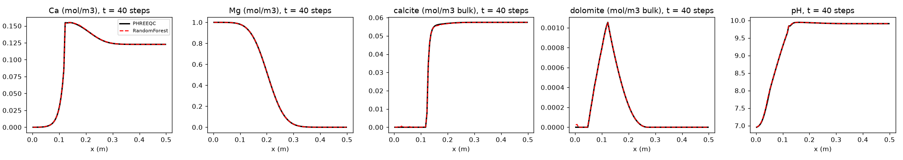

# ML surrogate of PHREEQC geochemistry (Engesgaard 1D)

Can a machine-learning model replace the chemistry step of a reactive-transport simulation?
Here we train a random forest on data produced by PHREEQC only (no transport code) for the
Engesgaard calcite-dolomite column, and we test it inside a small transport loop.

The study is organised so that it can be reproduced step by step.

## Repository layout
```
.
├── README.md
├── LICENSE                         MIT
├── environment.yml                 conda environment (Python 3.12, PhreeqcRM, scikit-learn, jupyter)
├── basic/                          START HERE: the whole study in four steps
│   ├── 01_generate_data.py         PHREEQC columns -> data/engesgaard_columns.csv (44 000 rows, ~3 s)
│   ├── 02_train_models.py          trains the random forest -> results/ (~10 s)
│   ├── 03_plots.ipynb              figures and explanations (already executed)
│   ├── 04_profile_with_models.py   benchmark column with the forest instead of PHREEQC (~10 s)
│   ├── common.py                   how the model inputs are built (raw + log10 of the totals)
│   ├── database/phreeqc.dat        PHREEQC database (USGS)
│   ├── data/                       generated by step 1 (not stored in git)
│   └── results/                    metrics.csv, test_predictions.npz, column_profiles.npz and the figures
└── advanced/                       extra material, not needed for the basics
    ├── data_generation/            generator with random-mixing and front chains, 1D and 2D cases, configs
    └── models/                     decision tree / random forest / XGBoost comparison, hybrid PHREEQC + model test
```

## Quick start (about 30 seconds)
```bash
conda env create -f environment.yml
conda activate ml-rtm
cd basic
python 01_generate_data.py
python 02_train_models.py
python 04_profile_with_models.py
jupyter notebook 03_plots.ipynb
```
Everything is deterministic (fixed seeds): two full runs give identical numbers.

## The idea in one paragraph
Every time step of a reactive-transport code has two parts: transport moves the dissolved totals (Ca, C, Cl, Mg)
along the column, and chemistry lets PHREEQC bring each cell to equilibrium (calcite) or to its kinetic rate
(dolomite). Step 1 simulates 11 small 1D columns (different flow speed and dispersion, 100 cells, 40 steps of 533 s) and
records every cell before and after the chemistry. Step 2 trains a random forest to predict that change from the
state the cell receives. Step 4 runs the Engesgaard benchmark column, which was **not** in the training data, with the
forest in place of PHREEQC for every cell and step.

## What you should get
Test R² for the change over one step (cells never seen in training):

| Ca (= C, calcite) | Mg (= dolomite) | pH after the step |
|---|---|---|
| 0.997 | 0.996 | 0.9999 |

Benchmark column, forest vs PHREEQC after 40 steps, max |error| / range of the PHREEQC profile (relative L2 in brackets):
Ca 1.1 % (0.2), calcite 1.1 % (0.3), dolomite 2.7 % (1.2), pH 2.3 %.

Prediction time is about 0.003 ms per cell against about 0.1 ms per cell for PHREEQC (PhreeqcRM) in this case, so the
chemistry step is roughly 35 times cheaper. This is chemistry only, in batches and in one thread; the transport and the
cost of calling the model from another code are not included. Last digits can differ across machines or library versions.



## Things worth knowing
- **The model learns the change over one step, not the final value.** Dolomite barely changes in a step, so a model that
  says "nothing happens" already gets R² 0.99 on the final value. The change is the part PHREEQC actually computes.
- **log10 inputs.** The forest gets log10 of Ca, C, Cl, Mg besides the raw values. Without them its pH has a flat
  plateau (~7.3) in the inlet cells (12.5 % of the range in the transport loop, 0.37 pH units even with exact inputs):
  pH depends on log10(C), but forests place their splits between training values on the linear scale. With them the pH
  error is 2.3 %. Remove the log columns in `common.py` to see it.
- **A good test R² is not enough.** Always run step 4. Tiny negative values predicted by the model are clipped to zero.
- **Caveat on the benchmark test.** The benchmark column is not used for training, but it was used to diagnose the pH
  problem and to choose the log10 inputs, so its numbers are somewhat optimistic. A fully clean test would use another
  column (another speed and dispersion) that nobody has looked at.
- The transport is a simple upwind + implicit-diffusion scheme, enough to generate realistic chemical states.
- Decision tree and XGBoost were tried and left out of `basic/` to keep it simple (see `advanced/`).
  XGBoost needed `subsample=1.0` and still oscillated in calcite at the front.

## Ideas for the next steps
GridSearch on the new data, a column that is held out and untouched, the 2D case, and a richer chemistry where the
model pays off more (here PHREEQC is already cheap, 0.1 ms per cell).

## License
MIT, see `LICENSE`. The PHREEQC database `phreeqc.dat` is distributed by the USGS.
